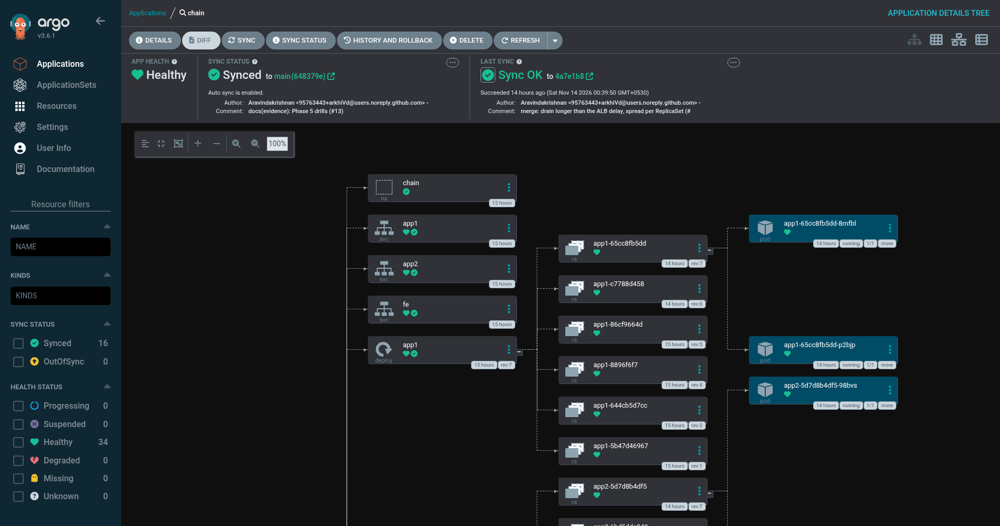
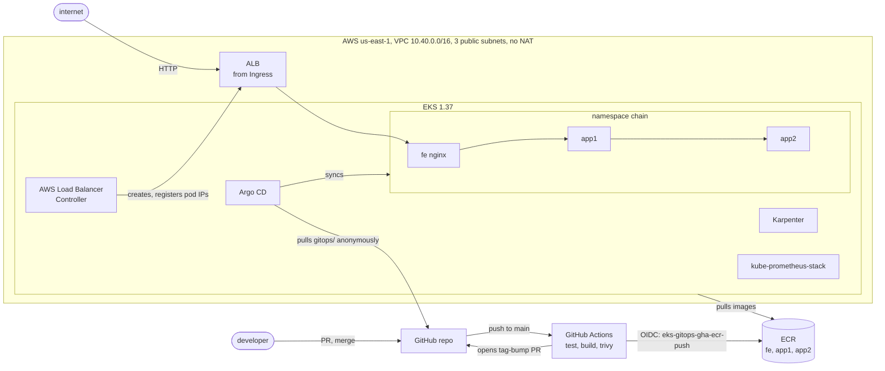
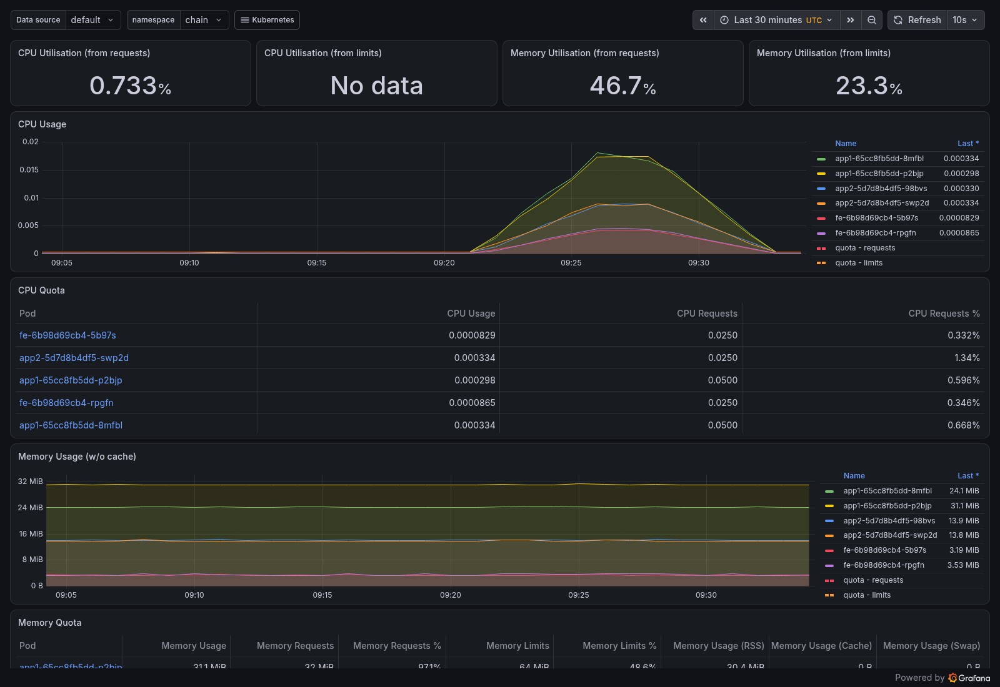

# eks-gitops-platform

An EKS 1.37 cluster built with Terraform, where Argo CD deploys everything from this repo and
GitHub Actions never gets cluster credentials. CI builds images, pushes them to ECR through
OIDC and opens a pull request that bumps the image tag. Merging that PR is the deploy.
Reverting it is the rollback.

I built it in nine days on an AWS free-plan account with $131.69 of credit that was going to
expire anyway. The cluster is temporary and gets destroyed by 2026-11-19. The repo, the
evidence in [`docs/evidence/`](docs/evidence/) and the decisions in [`docs/adr/`](docs/adr/)
are what stays.



## What it shows

| Claim | Evidence |
|---|---|
| CI has one AWS role, ECR push from `main` only, trusted by numeric repo and owner ID | [oidc-trust.md](docs/evidence/oidc-trust.md) |
| Cluster access through EKS access entries only, API endpoint limited to one CIDR | [cluster.md](docs/evidence/cluster.md) |
| Argo CD owns Karpenter, kube-prometheus-stack, storage and the app (app-of-apps, sync waves) | [platform.md](docs/evidence/platform.md) |
| A merged code change reaches running pods with no human `kubectl`, 61 s after the deploy PR merge | [deploy.md](docs/evidence/deploy.md) |
| NetworkPolicy default-deny with only `ALB → fe → app1 → app2` allowed | [deploy.md](docs/evidence/deploy.md) |
| Drift self-heals: a scaled Deployment and a deleted Service came back in 10 s | [drills.md](docs/evidence/drills.md) |
| HPA scales app1 from 2 to 6 at 665 req/s with 0.048% errors | [drills.md](docs/evidence/drills.md) |
| `git revert` of a deploy PR serves the old version 26 s after merge | [drills.md](docs/evidence/drills.md) |
| Full rollout behind the ALB with 0 of 9,000 requests failed | [drills.md](docs/evidence/drills.md), [ADR 0005](docs/adr/0005-alb-zero-downtime-rollouts.md) |
| Losing the node that ran Argo CD and Prometheus cost 0.09% of requests; Karpenter replaced it in the right AZ | [drills.md](docs/evidence/drills.md) |

## Architecture



- `bootstrap/` (local state): S3 state bucket, GitHub OIDC provider, the one CI role.
- `infra/` (S3 backend, native lockfile): VPC, EKS, a managed node group of
  2 × `m7i-flex.large`, managed add-ons, Pod Identity roles, and Helm releases for the Load
  Balancer Controller and Argo CD plus one root `Application`.
- `gitops/`: everything Argo CD syncs. `apps/` holds the child Applications,
  `platform/` holds storage, Karpenter node config and monitoring values, `workloads/chain/`
  holds the app as a Kustomize base.
- `app/`: three small services (nginx `fe`, Python `app1` and `app2`) with Dockerfiles and
  pytest.
- `.github/workflows/`: `validate.yml` (fmt, validate, tflint, checkov, trivy config,
  gitleaks, kubeconform, actionlint) and `app.yml` (build, scan, push, open deploy PR).

## Deploy flow

1. A PR to `app/` runs tests, builds all three images and scans them with trivy.
2. On merge, `app.yml` assumes `eks-gitops-gha-ecr-push` through OIDC, pushes images tagged
   with the first 12 characters of the commit SHA, and opens `deploy/<sha>` changing three
   `newTag` lines in `gitops/workloads/chain/kustomization.yaml`.
3. A human merges the deploy PR. Argo CD notices within its poll interval and rolls out.
4. Pods are not Ready until their ALB target is healthy (readiness gates). Old pods keep
   serving for 25 s after they start terminating, longer than the 15 s ALB deregistration
   delay.
5. Rollback is `git revert` of the deploy commit.

## Screenshots

Namespace `chain` during a 7-minute load run (09:21 to 09:28 UTC):



More: [Argo CD applications](docs/screenshots/argocd-apps.png),
[Grafana cluster view](docs/screenshots/grafana-cluster.png),
[Grafana network for chain](docs/screenshots/grafana-network.png).

## Cost

Cost Explorer, credits excluded, so these are the real charges the credit paid for:

| Day (UTC) | Spend | Note |
|---|---|---|
| 2026-11-01 to 11-10 | about $0.37/day | not this project: an older EBS volume in us-east-2 and KMS keys |
| 2026-11-11 | $5.89 | bootstrap, cluster up in the afternoon |
| 2026-11-12 | $7.85 | full day, platform and Karpenter tests |
| 2026-11-13 | $7.60 | full day, app and pipeline |

By service for 2026-11-11 to 11-13: EC2 compute $12.13, EKS $6.60, EC2 other (EBS) $1.52,
public IPv4 $0.74, KMS $0.19, ALB $0.16, ECR, S3 and SQS under $0.01 each.

A full day costs about $7.70, or $0.32/h, against the $0.35/h estimate in
[SPEC.md](SPEC.md#cost-and-limits). Running until teardown on 2026-11-19 puts the total near
$60 of the $131.69 credit. Phase 7 replaces this paragraph with the final number.

## Decisions

| ADR | Decision |
|---|---|
| [0001](docs/adr/0001-pull-based-gitops.md) | Pull-based GitOps; CI never holds cluster credentials |
| [0002](docs/adr/0002-pod-identity-and-access-entries.md) | EKS Pod Identity and access entries; no IRSA, no `aws-auth` |
| [0003](docs/adr/0003-public-subnets-no-nat.md) | Public subnets with no NAT gateway |
| [0004](docs/adr/0004-nodes-managed-plus-karpenter.md) | Managed node group for system pods, Karpenter for burst |
| [0005](docs/adr/0005-alb-zero-downtime-rollouts.md) | ALB IP targets, readiness gates, drain longer than deregistration |
| [0006](docs/adr/0006-no-ci-plan-role.md) | No Terraform plan or apply in CI |

## Free-plan constraints that shaped it

- Only free-tier-eligible instance types launch. The first node group on `t3.medium` failed,
  so nodes are `m7i-flex.large` and Karpenter may use only that and `c7i-flex.large`.
- The on-demand quota is 8 vCPU. Managed nodes use 4 and the Karpenter NodePool is capped
  at 4.
- Network Load Balancers are blocked, so the edge is an ALB.
- No Route 53 zone or ACM certificate, so the app is plain HTTP on the ALB hostname.

## What I would change for production

- Private subnets with NAT or VPC endpoints instead of public nodes ([ADR 0003](docs/adr/0003-public-subnets-no-nat.md)).
- TLS on the ALB with ACM and a real hostname, plus WAF.
- App-level metrics (request rate, latency, errors per service) and SLO alerts. The services
  expose none today, so Grafana shows only container and network metrics.
- An apply pipeline with a second approver instead of one operator's laptop
  ([ADR 0006](docs/adr/0006-no-ci-plan-role.md)).
- Argo CD Image Updater or a promotion flow across environments instead of one cluster.
- Signed images and an admission policy that checks signatures.

## Run it

Needs Terraform 1.15, AWS CLI, kubectl and an account where you can create EKS. Versions are
pinned in [SPEC.md](SPEC.md#pinned-versions).

```bash
# bootstrap defaults are this account and repo; override account_id and the github_* variables
terraform -chdir=bootstrap init && terraform -chdir=bootstrap apply

cp infra/terraform.tfvars.example infra/terraform.tfvars           # set operator_cidrs to your IP/32
terraform -chdir=infra init -backend-config=bucket=eks-gitops-tfstate-<account-id>
terraform -chdir=infra apply

aws eks update-kubeconfig --name eks-gitops --region us-east-1 --alias eks-gitops
kubectl --context eks-gitops -n argocd get applications
```

Teardown order matters because controllers own AWS resources Terraform does not know about:
delete the Ingress so the controller removes the ALB, delete the NodePool so Karpenter
terminates its nodes, then `terraform destroy` on `infra/` and `bootstrap/`.
